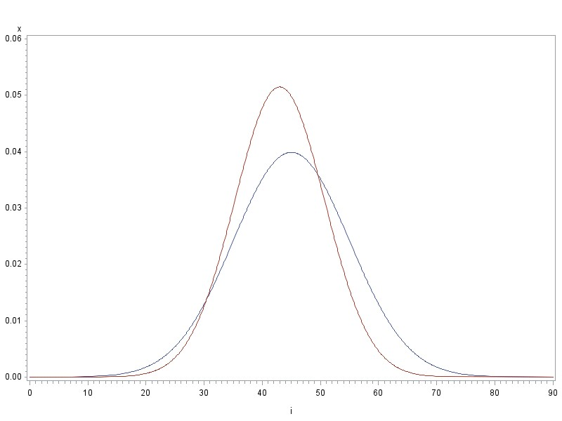

# Ratio and Regression Estimation

At this point, we are going to change focus for a bit. Rather than discussing different sampling designs, we're going to think about making the best use of survey data. Specifically, we're going to consider the case where in addition to the characteristic of interest ($y$), one or more additional variables related to $y$ are also available on that sampling unit. These additional variables are denoted by $x$ and are called **auxiliary variables**.

**Examples**:

\
\
\
\
\
\
\
\

Now, such auxiliary information can be used in setting up the sampling design.

\

However, we are now concerned with using it for the estimation of population characteristics. The general idea is that we will exploit the relationship between $y$ and $x$ to get more precise estimates than we could get from $y$ alone. We'll consider two methods for using this auxiliary information: ratio estimators and regression estimators.

In both cases, we may know the $x$s for the whole population or we may know the $x$s only for the sample.

**Examples**:

\
\
\
\
\
\
\

We're going to start with ratio estimators, and we're going to assume the traditional, design-based context. That is, we're going to assume:

\
\
\
\
\

## Ratio Estimation in the SRS

Here's the set-up we're going to start with:

\
\
\
\
\
\

This means we're assuming

\
\
\
\
\
\

There are two potential goals of ratio estimation.

1.  

\
\
\

2.  

\
\
\

\newpage

We'll need some new notation.

- Sampling plan:\

- $t_y =$\

- $\bar y_{\mathcal{U}} =$\

- $\bar y =$\

- $t_x =$\

- $\bar x_{\mathcal{U}} =$\

- $\bar x =$\

- $B =$

\

- $\hat B =$

 \
\

From these, we can get some pretty natural estimators for population characteristics:

\
\
\
\
\

Ratio estimators (and regression estimators) work best when there is a strong relationship between $y$ and $x$. We're assuming a linear relationship between them, so

\
\
\
\

\newpage

**Example**:

\
\
\
\
\
\

Before we jump into the properties of these estimators (bias, variance), let's explore why a ratio estimator may be useful.

### Why consider a ratio estimator?

**Maybe we actually want to estimate a ratio**.

Suppose we want to estimate average income per adult in the population. We record $y_i =$ household income and $x_i =$ number of adults living in a household.

\
\
\
\
\
\
\
\
\
\

The key question to ask is: if you took a different sample, would the denominator change? If yes, then you're using a ratio estimator.

\
\
\
\
\
\

\newpage

**Maybe we want to estimate a population total, but we don't know** $N$.

Up to now, we've used $\hat t = N \bar y$ to estimate a population total. But what if we don't know $N$?

\
\
\
\
\

**Example**: Suppose we want to estimate the amount of juice that will be produced by a shipment of oranges. We could take a sample of $n$ oranges and record $y_1,\dots, y_n$ (the amount of juice produced by each orange in the sample), and find the average amount of juice per orange, $\bar y$. But, to estimate the total amount of juice we'd need the total number of oranges in the shipment. What's easy to measure?

\
\
\
\
\
\
\

**Maybe we want to increase the precision of** $\bar y$ and $\hat t$.

This is one of the primary uses of ratio estimation--to get better estimates of the quantities we've already been focused on.

**Example**: A manager at a mill wants to estimate the total weight of dry wood ($t_y$) for a set number of truckloads of 5-foot bundles of pulp wood (freshly cut wood). The manager plans to:

1.  Weigh the total amount of pulp wood ($t_x$)

2.  Randomly select a sample of $n$ bundles

3.  Record the weight of the pulp wood ($x_i$) for each of the $n$ bundles

4.  Remove the bark and dry the wood from the $n$ bundles

5.  Record the weight of the dry wood ($y_i$) for each of the $n$ bundles

\
\
\
\
\
\

\newpage

**Maybe we need to adjust estimates from the sample to reflect demographic totals**.

We can use **poststratification** to adjust our estimates of population means and totals using information we know about the population.

**Example**: Suppose a small town of $N=4000$ registered voters wants to estimate the total number of people that plan to vote early. They can use this information to figure out how many poll workers they need for election day. The town records show that of the 4000 registered voters, 2100 are registered Democrats and 1900 are registered Republicans. They take a random sample of $n=200$ voters, and find that 39/85 registered Republicans plan to vote early and 75/115 registered Democrats plan to vote early.

\
\
\
\
\
\
\
\
\
\
\
\
\
\
\

Ratio estimation is used within each party, and we adjust our estimate accordingly. In this case:

\
\
\
\
\
\
\
\
\

**Maybe we're hoping to account for nonresponse**.

Not everyone responds to surveys and sometimes it's impossible to get data from each unit selected in our sample. But, if there's a relationship between $y$ and $x$ we can use that information to adjust our estimates.

\newpage

**Example**: Suppose we want to estimate the total amount of money UNL students spent on books in Fall 2026. We distribute a survey to randomly selected enrolled students and record $y_i =$ amount spent and $x_i =$ number of credit hours enrolled.

We know $t_x=$

\
\
\
\
\
\
\
\
\
\
\
\
\
\
\
\
\
\
\
\
\
\

So, there are many reasons why we may want to use a ratio estimator. However, if we want to use them we need to know their properties so we can understand their behavior and calculate quantities like confidence intervals.

### Ratio estimators and their properties

Unlike $\bar y$ or $\hat t = N \bar y$ in a SRS or stratified random sample, ratio estimators are usually biased for estimating $\bar y_{\mathcal{U}}$ and $t_y$. This is bias inherent to the estimation method, not selection bias.

\newpage

**Example**: Suppose we want to estimate the total number of fish caught on a given day in nets at $N=4$ sites. The entire population is

|             |     |     |     |     |
|-------------|-----|-----|-----|-----|
| $i$: site   | 1   | 2   | 3   | 4   |
| $x_i$: nets | 4   | 5   | 8   | 5   |
| $y_i$: fish | 200 | 300 | 500 | 400 |

We will take a SRS of $n=2$ sites and use ratio estimation to estimate the total number of fish caught. We know:

- $t_y =$\

- $t_x =$\

- ${N \choose n} = {4 \choose 2} =$\

In this super small example, we can list all the possible samples.

| Sample | Units | $\bar x_{\mathcal{S}}$ | $\bar y_{\mathcal{S}}$ | $\hat B$ | $\hat t_{yr} = \hat B t_x$ | $\hat t_{SRS}$ |
|-----------|-----------|-----------|-----------|-----------|-----------|-----------|
| 1 | 1,2 | $\hbox{\hspace{20mm}}$ |  |  |  |  |
|  |  |  |  |  |  |  |
| 2 | 1,3 |  |  |  |  |  |
|  |  |  |  |  |  |  |
| 3 | 1,4 |  |  |  |  |  |
|  |  |  |  |  |  |  |
| 4 | 2,3 |  |  |  |  |  |
|  |  |  |  |  |  |  |
| 5 | 2,4 |  |  |  |  |  |
|  |  |  |  |  |  |  |
| 6 | 3,4 |  |  |  |  |  |
|  |  |  |  |  |  |  |

\newpage

So if the ratio estimator is biased, why do we use it? We hope the reduced variance will compensate for the bias. That is, if $x$ and $y$ are highly (positively) correlated, we expect that the sampling distributions of $\bar y$ and $\hat{\bar y_r}$ will look like this compared to each other.

{fig-align="center"}

We have a quantity that summarizes both bias and variance!

\

\newpage

**Example**:

| Sample | Units | $\hat t_{yr}$ | $[\hat t_{yr} - \hbox{E}(\hat t_{yr})]^2$ | $\hat t_{SRS}$ | $[\hat t_{SRS} - \hbox{E}(\hat t_{SRS})]^2$ |
|------------|------------|------------|------------|------------|------------|
| 1 | 1,2 | 1222 |  | 1000 |  |
|  |  |  |  |  |  |
| 2 | 1,3 | 1283 |  | 1400 |  |
|  |  |  |  |  |  |
| 3 | 1,4 | 1467 |  | 1200 |  |
|  |  |  |  |  |  |
| 4 | 2,3 | 1354 |  | 1600 |  |
|  |  |  |  |  |  |
| 5 | 2,4 | 1540 |  | 1400 |  |
|  |  |  |  |  |  |
| 6 | 3,4 | 1523 |  | 1800 |  |
|  |  |  |  |  |  |

\
\
\
\
\
\
\
\
\
\

Why is the bias there? Let's look at E$[\hat{\bar y_r}]$:

\
\
\

\newpage

Can we be more specific about the bias? Let's consider the bias of $\hat{\bar y_r}$:

\
\
\
\
\
\
\
\
\
\
\
\
\
\
\
\
\
\
\
\
\
\
\
\
\
\
\
\
\
\

From this, we could show:

\
\
\
\
\

\newpage

It can also be shown that:

\
\
\
\
\

What does all this mean? The take home message is the bias of $\hat{\bar y_r}$ (and $\hat t_{yr}$ and $\hat B$) is small if:

- \

- \

- \

- \

- \

If the bias is small, we can approximate both the variance and the MSE using

\
\
\
\
\
\
\

Again, what does all this mean? The bottom line is the MSE and variance of $\hat{\bar y_r}$ (and $\hat t_{yr}$ and $\hat B$) is small if:

- $n$ is large

- sampling fraction $\frac{n}{N}$ is large

- correlation $R$ is close to 1

- \

\newpage

This approximation for the variance/MSE is still full of quantities we don't know! How can we get estimated variances based on the data we observed so we can calculate confidence intervals? Let's start with $\hat B$:

\
\
\
\
\
\
\
\
\
\
\
\

From this, we can see what we'll use for $\hat{\bar y_r}$ and $\hat t_{yr}$:

\
\
\
\
\
\
\
\
\
\
\
\

We can then use these variances as we have before: take the square root to get the SE and find confidence intervals:

\
\
\
\
\
\
\
\

\newpage

**Example**: Let's look at the orange juice example we considered earlier. The total shipment of oranges weighed 2000 pounds. 15 oranges were randomly selected. Let $y_i =$ the weight of the orange and let $x_i =$ the weight of the juice extracted from the orange.

| Orange | $y$  | $x$  | $y-\hat B x$ | $(y-\hat B x)^2$         |
|--------|------|------|--------------|--------------------------|
| 1      | 0.16 | 0.22 | 0.014866     | 0.000220998              |
| 2      | 0.15 | 0.26 | -0.021522    | 0.000463196              |
| 3      | 0.2  | 0.31 | -0.004507    | $2.0313 \times 10^{-5}$  |
| 4      | 0.25 | 0.37 | 0.005911     | $3.49399 \times 10^{-5}$ |
| 5      | 0.16 | 0.28 | -0.024716    | 0.000610881              |
| 6      | 0.27 | 0.38 | 0.019314     | 0.000373031              |
| 7      | 0.28 | 0.4  | 0.01612      | 0.000259854              |
| 8      | 0.16 | 0.21 | 0.021463     | 0.00046066               |
| 9      | 0.11 | 0.18 | -0.008746    | $7.64925 \times 10^{-5}$ |
| 10     | 0.16 | 0.29 | -0.031313    | 0.000980504              |
| 11     | 0.17 | 0.26 | -0.001522    | $2.31648 \times 10^{-6}$ |
| 12     | 0.24 | 0.32 | 0.028896     | 0.000834979              |
| 13     | 0.21 | 0.33 | -0.007701    | $5.93054 \times 10^{-5}$ |
| 14     | 0.11 | 0.16 | 0.004448     | $1.97847 \times 10^{-5}$ |
| 15     | 0.22 | 0.35 | -0.010895    | 0.000118701              |
| Total  | 2.85 | 4.32 |              | 0.00454                  |

\
\
\
\
\
\
\
\
\
\

\newpage

### Sampling weights

Recall the sampling weight is $w_i = 1/\pi_i$, where $\pi_i$ is the inclusion probability. In previous chapters (SRS and Stratified) we observed that we we could use the sampling weights to get our estimates of population (or subpopulation) quantities. For example,

\
\
\
\
\

But, we also know

\
\
\
\
\
\

So, these $\bar x_{\mathcal{U}}/\bar x$ (or $t_x/\hat t_x$) values serve as an adjustment to each sampling weight. Why do the weights need adjusting?

\
\
\
\
\
\

We're assuming

\
\
\
\
\
\

\newpage

Let's add some data to the plot.

{fig-align="center"}

If $\bar x < \bar x_{\mathcal{U}}$

\
\
\
\

\newpage

If $\bar x > \bar x_{\mathcal{U}}$

\
\
\
\
\

So, back to $t_x/\hat t_x$ as an adjustment to the sampling weights. Call this adjustment $g_i$:

\
\
\

We now have adjusted weights $w_i^* = w_i g_i$ and we can think about our estimator as

\
\
\
\

What makes these different from the sampling weights we saw earlier?

\
\
\
\
\
\

This means the sampling weights no longer sum to $N$, which they have done in previous sections. Instead, they are calibrated to the population total of the $x$s, $t_x$.

\newpage

**Example**: Let's go back to our small example.

|             |     |     |     |     |
|-------------|-----|-----|-----|-----|
| $i$: site   | 1   | 2   | 3   | 4   |
| $x_i$: nets | 4   | 5   | 8   | 5   |
| $y_i$: fish | 200 | 300 | 500 | 400 |

\
\
\
\
\
\
\
\
\
\
\
\
\
\
\
\
\
\
\
\
\
\

\newpage

### Analysis in R

We'll still need to set up a design, using the `svydesign` function. Since we're still assuming a SRS it will look just like it did before:

`design<-svydesign(id=~1, weights=~sampwt, fpc=rep(N,n), data=dataset)`

These are the unadjusted sampling weights, just the inverse of the inclusion probability. If we don't know $N$, we can set the sampling weights to all be 1 and omit the fpc.

There's a new function, `svyratio`, that will estimate $B$ using $\bar B = \bar y/\bar x$ along with its standard error. It has the syntax:

`est_ratio<-svyratio(numerator = ~y, denominator=~x, design=design)`

We could also get a confidence interval for the ratio using the `confint` function. Once we have the estimated ratio, we can use the `predict` function to get the ratio estimates of $\bar y_{\mathcal{U}}$ and $t$. We will need to specify $t_x$, the population total of the $x$s. We use the syntax:

```         
    xtotal<-value
    predict(est_ratio,total=xtotal)
    predict(est_ratio,total=xtotal/N)
```

**Example**: Back on Homework 1, you worked with the 'counties' data that includes information on land area, population, number of physicians, and other characteristics for a SRS of 100 counties (out of the 3141 counties) in the US. The data was collected in 1993 and at that time the total land area was 3536278 square miles and total population was 255077536.

Let's start by considering the characteristic of interest $y =$ number of physicians and use $x =$ population as an auxiliary variable.

We'll start by looking at the SRS estimate so we can compare.

```{r}
#| warning: false

counties<-read.csv("counties.csv",header=TRUE)
N<-3141
n<-nrow(counties)
counties$sampwt<-rep(N/n,n)

library(survey)
countiesdesign<-svydesign(id=~1, weights=~sampwt, fpc=rep(N,n), data=counties)

#SRS estimate#
totphys<-svytotal(~physician,countiesdesign)
totphys
```

Now we can add our auxiliary variable. We'll first check the correlation between $y$ and $x$:

```{r}
cor(counties$physician, counties$totpop)
```

This is high! Population should be a good auxiliary variable. We'll estimate the ratio

```{r}
Bhatphys<-svyratio(numerator=~physician,denominator=~totpop,design=countiesdesign)
Bhatphys
```

and use that to estimate the total number of physicians ($\hat t_y$)

```{r}
xtotal<-255077536
predict(Bhatphys,total=xtotal)
```

Look at the reduction in the SE!

\newpage

Now let's consider the characteristic of interest $y =$ farm population and use $x =$ land area as an auxiliary variable. Again, we'll start with the SRS estimate.

```{r}
totfarmpop<-svytotal(~farmpop,countiesdesign)
totfarmpop
```

We'll compare it to the ratio estimate.

```{r}
Bhatfarmpop<-svyratio(numerator=~farmpop,denominator=~landarea,design=countiesdesign)
Bhatfarmpop

landtotal<-3536278
predict(Bhatfarmpop,total=landtotal)
```

The SE more than doubled! What's going on?

```{r}
cor(counties$farmpop,counties$landarea)
```

\

## Regression Estimation

With ratio estimation, we assumed a proportional relationship between our characteristic of interest $y$ and an auxiliary variable $x$:

\
\
\

In the last section, we noted that assuming this relationship is equivalent to regression through the origin. Sometimes the relationship between $x$ and $y$, even if strong, is not well represented by this assumption. Instead, perhaps a straight line with an intercept is a better depiction of the relationship:

\
\
\

**Example**: Suppose we want to estimate total yield of a crop in a field with $N=100$ plots. We randomly select $n=4$ plots using a SRS and in each plot we measure $y_i=$ yield. Also available is the amount of fertilizer applied to the plot. This information is available on all 100 plots.

\
\
\
\

The new estimator we'll use is called a **regression** estimator, and we'll focus on estimating $\bar y_{\mathcal{U}}$. From $\bar y_{\mathcal{U}}$, we can extend to estimating $t_{y}$. Estimating $\bar y_{\mathcal{U}}$ turns out to be a pretty simple operation.

\
\
\
\
\

Assume the relationship between $x$ and $y$ follows

\
\
\
\
\

\newpage

Let $\hat B_0$ and $\hat B_1$ be the usual ordinary least squares estimates of the intercept and slope (the typical regression estimators):

\
\
\
\
\
\

Before, with the ratio estimator

\
\
\
\
\

Now,

\
\
\
\
\
\
\
\

Again, the resulting regression estimator is an adjustment to the basic SRS estimator, and the adjustment is serving the same purpose it did with the ratio estimator.

\
\
\
\
\
\
\
\

\newpage

Like the ratio estimator, the regression estimator is biased. But wait? Aren't the OLS estimators unbiased? What's going on?

\
\
\
\
\
\
\
\

With the ratio estimator, we showed

\

With the regression estimator,

\

Like the ratio estimator, the bias in the regression estimator is negligible with large samples.

Also like the ratio estimator, our estimated variance for $\hat{\bar y}_{reg}$ will be based on the variance of the residuals. But now,

\
\
\
\
\
\
\
\
\
\

You will sometimes also see the variance estimated using

\
\
\

This makes a bigger difference with small samples.

\newpage

We can use $\hat{\bar y}_{reg}$ to estimate a population total. Recall that

\
\

So, it should be intuitive to use

\
\
\
\
\
\
\
\

**Example**: Let's go back to the example we considered at the beginning of this section. We want to estimate total crop yield in a field with $N=100$ plots. We use a SRS to randomly select $n=4$ plots and measure $y_i =$ yield in the plot. We also know $x_i =$ fertilizer applied to the plot. We know that $\bar x_{\mathcal{U}} = 100$. Here are the data:

| $x_i$ | $y_i$ | $x_i - \bar x$ | $y_i -\bar y$ | $(x_i-\bar x)(y_i-\bar y)$ | $(x_i- \bar x)^2$ |
|------------|------------|------------|------------|------------|------------|
| 50 | 1410 |  |  |  |  |
| 100 | 1690 |  |  |  |  |
| 150 | 1680 |  |  |  |  |
| 200 | 1850 |  |  |  |  |

\
\
\
\
\
\
\

\newpage

**Example**: The Florida Game and Fish Commission is interested in estimating the average weight of alligators. They plan to use alligator length as an auxiliary variable, because it is much easier to observe. In fact, they've already collected so much length data they are confident that $\bar x_{\mathcal{U}} \approx 90$. They capture and measure $n=22$ alligators and measure the length (inches) and weight (pounds) on each one. The data are in 'alligator.csv.' What don't we have?

\
\

We'll estimate the average alligator weight a few different ways: using summary statistics calculated in R, using the `lm` function in R to fit the regression, and using the `survey` package. In the `survey` package, there is a new function, `svyglm`. It has the general syntax:

```         
 svyglm(y ~ x, design = design)
```

Like with ratio estimation, we can then use the `predict` function to estimate $\bar y_{\mathcal{U}}$ and $t_y$.

**Using Summary Statistics**:

```{r}
alligator<-read.csv("alligator.csv",header=TRUE)
head(alligator)

n<-nrow(alligator)

##### Summary Stats ###########

xbar<-mean(alligator$Length)
xbar
ybar<-mean(alligator$Weight)
ybar
varx<-var(alligator$Length)
varx
vary<-var(alligator$Weight)
vary
corrxy<-cor(alligator$Length,alligator$Weight)
corrxy

bhat1<-corrxy*sqrt(vary)/sqrt(varx)
bhat0<-ybar-bhat1*xbar
bhat1
bhat0

xbarU<-90

ybarhatreg<-ybar+bhat1*(xbarU-xbar)
ybarhatreg

alligator$resid<-alligator$Weight - (bhat0+bhat1*alligator$Length)
s2e<-sum(alligator$resid**2)/(n-1)
s2e
```

\newpage

**Using the `lm` function in R**: We can fit the regression model directly in R

```{r}
alreg<-lm(Weight~Length,data=alligator)
alreg
anova(alreg)
```

\newpage

**Using the `survey` package**:

```{r}
library(survey)
aldesign<-svydesign(id=~1, weights=~1, data=alligator)

alreg2<-svyglm(Weight~Length,design=aldesign)
summary(alreg2)

xbarU<-data.frame(Length=90)

predict(alreg2,xbarU)
confint(predict(alreg2,xbarU),df=n-2)
```

\newpage

## Domain Estimation

Sometimes we're interested in estimating characteristics (means, totals, proportions) for subpopulations. But wait, don't we already know how to do this? We estimated subpopulation characteristics when we discussed stratified sampling.

Here's what is different: now we're considering the situation where the sampling design did not include stratification. That is,

\
\
\
\
\
\
\
\
\

This is called **domain estimation**, and is a special case of ratio estimation.

**Example**: We are interested in comparing transportation challenges in low-income households with other households. A sampling frame of households is available, but we don't have information on household income.

\
\
\
\
\
\
\
\
\
\
\
\
\

\newpage

Our first inclination might be to use the sample mean for the domain

\
\

But, $n_d$ for each domain is not fixed by the design. $n_d$ was unknown prior to drawing the sample. This means the denominator is a random variable.

Instead, we'll use ratio estimation (with some new variables $u_i$ and $x_i$) to estimate domain means, totals, and proportions.

Let's set up the framework for domain estimation, and some new notation. We'll divide the population into $D$ mutually exclusive and exhaustive domains.

\
\
\
\
\
\
\
\

We'll denote our domain sizes as

\
\
\

After collecting data, we can observe/calculate the number of sampling units in each domain.

\
\
\

In domain estimation:

- \

- \

- \

\newpage

We can contrast this with what we do know:

- \

- \

So, of course we have some new notation:

- $\mathcal{U}_d=$\

- $\mathcal{S}_d=$\

- $\bar y_{\mathcal{U}_d} =$\

- $t_{\mathcal{U}_d} =$\

These are population values, and $i \in \mathcal{U}_d$ means

\
\
\
\
\
\

**Example**: (book problem #4) A SRS of $n=1500$ licensed boat owners was sampled from a list of $N=400,000$ names of currently licensed boat owners. There are two domains of interest: owners of large motorboats (over 16 feet) and boat owners who own something other than a large motorboat. After collecting data, the researchers observed they had sampled $n_1 = 472$ owners in domain 1 and $n_2=1028$ owners in domain 2. The boat owners were asked to report $y_i =$ how many children they have. We want to estimate:

- the mean number of children for boat owners in domain 1\

- the total number of children for large boat owners\

Now, the population domain mean is

\
\

\newpage

We're going to need some new variables. The first one really isn't new. We're going to construct our denominator using

\
\
\

We can still think of this as an auxiliary variable!

So, for domain 1 in our example:

\
\
\

For our numerator, we'll define

\
\
\
\

In our example,

\
\
\

So, our population ratio is now

\
\
\
\

and our ratio estimator for $\bar y_{\mathcal{U}_d}$ is

\
\
\
\

\newpage

**Example**: So, to summarize $y_i$, $u_i$, and $x_i$ in our example:

\
\
\
\
\
\
\
\
\
\

So, an excerpt of the full data set might look something like this:

| Owner    | Domain | Num. Kids ($y_i$) | Numerator ($u_i$) | Denominator ($x_i$) |
|---------------|---------------|---------------|---------------|---------------|
| 1        | 1      | 3                 |                   |                     |
| 2        | 1      | 2                 |                   |                     |
| 3        | 2      | 5                 |                   |                     |
| 4        | 1      | 0                 |                   |                     |
| 5        | 2      | 0                 |                   |                     |
| 6        | 2      | 1                 |                   |                     |
| 7        | 1      | 1                 |                   |                     |
| 8        | 2      | 2                 |                   |                     |
| $\vdots$ |        |                   |                   |                     |

If we focus on Domain 1 (large motorboats), we can summarize the data as follows:

| $y_i$ | Num. Respondents |
|-------|------------------|
| 0     | 1104             |
| 1     | 139              |
| 2     | 166              |
| 3     | 63               |
| 4     | 19               |
| 5     | 5                |
| 6     | 3                |
| 8     | 1                |
| Total | 1500             |

\newpage

So, 
$$
\bar u =  \hspace{150mm}
$$

and

$$
\bar x =  \hspace{150mm}
$$

Then,

\
\
\

We do still need to figure out the estimated variance!

When we initially talked about ratio estimation, we noted that

\
\
\

So now,

\
\
\
\
\
\
\
\
\
\
\
\
\
\
\

If $n_d$ and $n$ are large then $n_d - 1 \approx n_d$ and $n \approx n-1$, so

\newpage

**Example**:

\
\
\
\
\
\
\
\
\
\
\
\
\
\
\
\
\
\
\
\

Suppose instead we are interested in estimating the total for a domain:

There are two possibilities:

1.  $N_d$ is known

\
\
\

2.  $N_d$ is unknown

\
\
\
\
\

\newpage

**Example**: We don't know the total number of boat owners that fall into Domain 1.

\
\
\
\
\
\
\
\
\
\
\
\
\
\
\
\
\
We can construct confidence intervals for domain estimates

\
\
\

We can also compare domains using hypothesis testing!

\
\
\
\
\
\
\
\
\
\
\
\
\
\
\

\newpage

We can use R to carry out domain estimation. It's easiest to use the `subset` or `svyby` functions in the `survey` package to do so. If we've already set up our design using `svydesign` we can use the `subset` function to redefine the design for the domain of interest. The generic syntax is

```         
newdesign<-subset(design,domain)
```

Let's check our boats estimates in R. The first thing we need to do is get the data ready for analysis.

```{r}
boats <- data.frame(
  numkids=c(0,1,2,3,4,5,6,8),
  dom1=c(76,139,166,63,19,5,3,1),
  dom2=c(528,189,225,76,8,2,0,0))

boats

boatdom1<-boats[rep(1:nrow(boats),times=boats$dom1),]
boatdom1$dom<-1
boatdom2<-boats[rep(1:nrow(boats),times=boats$dom2),]
boatdom2$dom<-2
boatdf<-rbind(boatdom1,boatdom2)
dim(boatdf)
head(boatdf)

N<-400000
n<-nrow(boatdf)
boatdf$sampwt<-N/n
head(boatdf)
```

Now we can find the estimates:

```{r}
#| warning: false
library(survey)

boatdesign<-svydesign(id=~1,weights=~sampwt,fpc=rep(N,n),data=boatdf)
dlarge<-subset(boatdesign,dom=='1')
smean1<-svymean(~numkids,design=dlarge)
smean1
stot1<-svytotal(~numkids,dlarge)
stot1
bothmean<-svyby(~numkids,by=~factor(dom),design=boatdesign,svymean)
bothmean
```

## Poststratification

We mentioned **poststratification** earlier as a reason we might want to use ratio estimation, as it allows us to adjust for demographics or similar. How is it different from stratification?

\
\
\
\
\

In the study process, poststratification fits in like this:

**Before the study**: Information is either not available on poststrata membership, or it's not used in designing the study. Information is available on poststrata sizes ($N_h$) and these values are fixed.

**During the study**: Obtain information on poststrata membership, along with other responses.

**After the study**: Data includes poststrata membership and responses for each sampling unit. Researcher has $n_h$, which are random. Can now estimate poststratum sample means (totals) and pool them for an overall population estimate based on poststratification weights.

Here's the set up

\
\
\
\
\
\
\
\
\
\
\
\

The estimation process is basically the same as domain estimation, but now $N_1,\dots, N_h$ are known and the values can be used in estimation. So, for example,

\
\

\newpage

Define

\
\
\

In ratio estimation, weights were calibrated to add to $t_x$ (we saw this with the small fish/nets examples). Now,

\
\
\
\

So we can get ratio estimates for the poststrata totals (means)

\
\
\
\
\

and then pool across them just like we did in stratified sampling

\
\
\
\
\
\
\
\

Remember that stratification was not built into the sampling design, so if an SRS was used as the design and $n_h$ (and thus $n$) is pretty large, we can use the variance from proportional allocation:

\
\
\
\
\
\
\

\newpage

Often, you'll hear pollsters talk about weighting the data. What they are doing is using poststratification weights. As mentioned above, poststratification modifies the sampling weights to they sum to $N_h$ in poststratum $h$. Remember that in an SRS,

\
\

and in stratified

\
\

Now, based on the way we've defined $x_{ih}=$

\
\
\
\
\
\

So we can write our poststratification population estimates the same way we did with simple random samples back in Chapter 3:

\
\
\
\
\
\
\

\newpage

**Example**: Let's revisit the faculty publication data we used back in Chapter 4, and suppose that the data were collected as a SRS. The researchers knew how many faculty fell into each discipline class, but only had faculty names and emails available for the sampling frame. They drew a random sample of $n=50$ faculty members from the $N=807$ and asked them about both their discipline and the number of publications they had in the last year.

| Stratum | $N_h$ | $n_h$ | $\hat N_h$ | $w_i$ | $w_i^*=\frac{N_h}{\hat N_h}w_i$ | $\bar y_h$ | $s_h^2$ |
|----------|-------|------|----------|----------|----------|----------|----------|
| Bio Sci | 102 | 7 |  |  |  | 3.14 | 6.81 |
|  |  |  |  |  |  |  |  |
| Phy Sci | 310 | 19 |  |  |  | 2.105 | 8.21 |
|  |  |  |  |  |  |  |  |
| Soc Sci | 217 | 13 |  |  |  | 1.231 | 4.359 |
|  |  |  |  |  |  |  |  |
| Humanities | 178 | 11 |  |  |  | 0.4545 | 0.8727 |
|  |  |  |  |  |  |  |  |
| Total | 807 | 50 |  |  |  |  |  |

\
\
\
\
\
\
\
\
\
\
\
\
\
\
\

\newpage

```{r}
#| echo: false

biopubs<-c(rep(0,1),rep(1,2),rep(3,1),rep(5,2),rep(7,1))
phypubs<-c(rep(0,10),rep(1,2),rep(3,1),rep(4,2),rep(5,1),rep(6,1),rep(8,2))
socpubs<-c(rep(0,9),rep(2,1),rep(4,2),rep(6,1))
humpubs<-c(rep(0,8),rep(1,2),rep(3,1))

biopubsdf<-data.frame(biopubs)
phypubsdf<-data.frame(phypubs)
socpubsdf<-data.frame(socpubs)
humpubsdf<-data.frame(humpubs)

biopubsdf$discipline<-"Biological"
biopubsdf$pubs<-biopubsdf$biopubs
biopubsdf$Nh<-102
biopubsdf$samp<-7
biopubsdf<-biopubsdf[,c(2,3,4,5)]
phypubsdf$discipline<-"Physical"
phypubsdf$pubs<-phypubsdf$phypubs
phypubsdf$Nh<-310
phypubsdf$samp<-19
phypubsdf<-phypubsdf[,c(2,3,4,5)]
socpubsdf$discipline<-"Social"
socpubsdf$pubs<-socpubsdf$socpubs
socpubsdf$Nh<-217
socpubsdf$samp<-13
socpubsdf<-socpubsdf[,c(2,3,4,5)]
humpubsdf$discipline<-"Humanities"
humpubsdf$pubs<-humpubsdf$humpubs
humpubsdf$Nh<-178
humpubsdf$samp<-11
humpubsdf<-humpubsdf[,c(2,3,4,5)]

pubsdf<-rbind(biopubsdf,phypubsdf,socpubsdf,humpubsdf)
```

I set up the data as we did in Chapter 4. We can check our work use the `postStratify` function in the `survey` package. We set up the design in `svydesign` assuming a SRS:

```{r}
N<-807
n<-nrow(pubsdf)
pubsdesign<-svydesign(id=~1,weights=rep(N/n,n),fpc=rep(N,n),data=pubsdf)
```

and then tell R the size of each poststratum:

```{r}
pop.disc<-data.frame(discipline=c("Biological","Physical","Social","Humanities"),
                  Freq=c(102,310,217,178))
pop.disc
```

We can use `postStratify` to set up the poststratification weights.

```{r}
pubsdesps<-postStratify(pubsdesign,~discipline,pop.disc)
summary(pubsdesps)
1/unique(pubsdesps$prob)
```

\newpage

Then once those weights are set up, we can use `svymean` and `svytotal` just like before

```{r}
svymean(~pubs,pubsdesps)
svytotal(~pubs,pubsdesps)
```

We can compare these to the SRS estimates

```{r}
svymean(~pubs,pubsdesign)
svytotal(~pubs,pubsdesign)
```

## Ratio Estimation with Stratified Sampling

Everything we've done so far with ratio and regression estimations assumed the sampling design was SRS. But, these concepts can be applied to any sampling design, including stratified sampling. We just have to set up the design to include the stratification.

**Example**: On Homework 4, you used the auxiliary variable of $x_i =$ number of acres devoted to farming in 1987 along with the response $y_i =$ number of acres devoted to farming in 1992. There's another version of this data set (`agstrat`) on Dr. Lohr's website that includes a stratification variable: region (North Central, Northeast, South, and West). The manual on using R to carry out these analyses linked in Canvas shows example code implementing ratio estimation with stratification using this data set.
